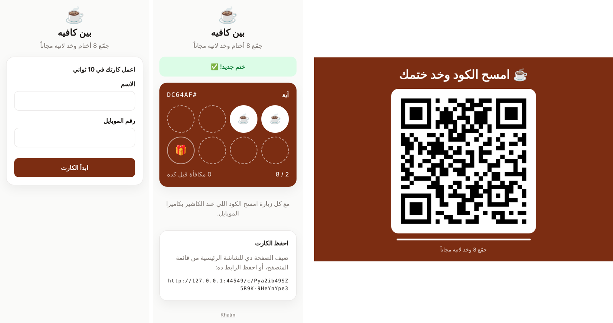
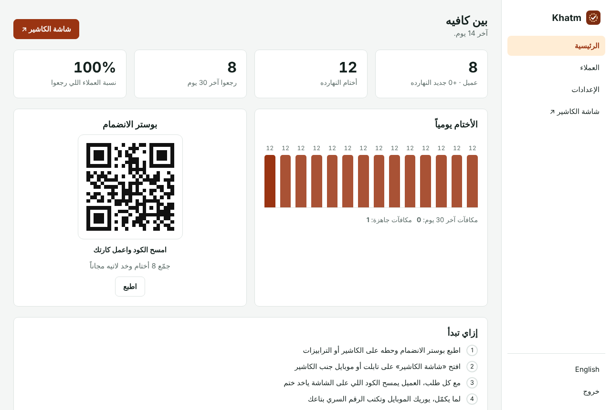
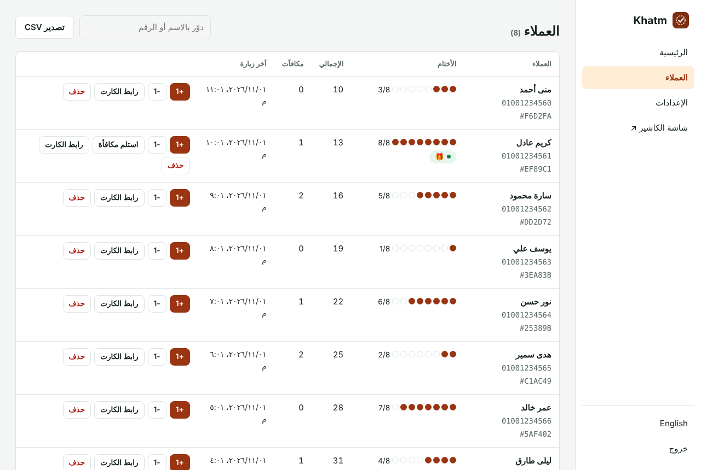

<div align="center">

# Khatm · ختم

**A digital loyalty stamp card for cafés, restaurants, salons and shops.**
Customers scan a QR code at the counter and collect stamps on their phone. No app to install, no plastic cards, no monthly fees. Self-hosted.

[](https://www.hostinger.com/docker-hosting?compose_url=https://raw.githubusercontent.com/mashraf1997/khatm/main/docker-compose.yml&REFERRALCODE=YOUR_REFERRAL_CODE)

[English](#how-it-works) · [العربية](#بالعربي)



</div>

---

## How it works

1. **Print the join poster.** Customers scan it, type their name and phone number, and get their card. It opens in the browser, so there is nothing to install.
2. **Open the counter screen** on a tablet or old phone next to the till. It shows a QR code that changes every minute.
3. **With every order, the customer scans the counter code** with their phone camera and gets a stamp.
4. **When the card is full,** the customer shows their phone and staff type the PIN to hand over the reward. Extra stamps carry over to the next card.

## Why it is hard to cheat

- The counter QR code **changes every minute** and each code gives one stamp per card, so a photo of it shared in a group chat stops working.
- A **cooldown** (30 minutes by default) stops repeated scans in one visit.
- Rewards need the **staff PIN**, and PIN guesses are rate-limited.
- A phone number cannot be used to take over someone else's card.

## For the owner

- Customers list with search by name or phone, stamps, rewards and last visit.
- Add or remove stamps by hand, redeem rewards, and show a customer their card link as a QR code when they switch phones.
- Stats: new customers, stamps per day, customers who came back, rewards redeemed.
- Choose the number of stamps, the reward, welcome stamps, colors and emoji.
- Export customers to CSV, for example to send them an offer.
- Arabic and English, right-to-left ready.

<p align="center">
  
  
</p>

## Deploy

**One click:** press **Deploy on Hostinger** above, open `http://YOUR-SERVER-IP` and create your password. For customers' phones, a domain with HTTPS looks more trustworthy, and it lets them add the card to their home screen.

**Docker:**

```bash
git clone https://github.com/mashraf1997/khatm.git && cd khatm
docker compose up -d
```

**Node.js 20+:** `npm install && npm start`

| Variable | Default | Purpose |
|---|---|---|
| `PORT` | `3000` | HTTP port |
| `DATA_DIR` | `./data` | Where `khatm.json` is stored. Back it up. |
| `SETUP_TOKEN` | *(empty)* | Required to create the first admin when set |

## Development

```bash
npm test
```

One dependency (`qrcode`). No database server.

## Works well with

- [**Dukkan**](https://github.com/mashraf1997/dukkan): your WhatsApp ordering store and QR menu.
- [**Wakeel**](https://github.com/mashraf1997/wakeel): an AI employee that answers your customers on WhatsApp.
- [**Nashr**](https://github.com/mashraf1997/nashr): AI-written social media posts, published on schedule.
- [**Mawid**](https://github.com/mashraf1997/mawid): your booking page.

## License

MIT

---

<div dir="rtl">

## بالعربي

**ختم** كارت ولاء ديجيتال للكافيهات والمطاعم والصالونات والمحلات. العميل يمسح كود عند الكاشير ويجمّع أختام على موبايله. من غير تطبيق، ومن غير كروت ورق، ومن غير اشتراك شهري.

1. اطبع بوستر الانضمام. العميل يمسحه ويكتب اسمه ورقمه، وكارته يتعمل في ثواني.
2. افتح شاشة الكاشير على تابلت أو موبايل قديم. الكود اللي عليها بيتغير كل دقيقة.
3. مع كل طلب، العميل يمسح الكود وياخد ختم.
4. لما الكارت يكمل، الكاشير يكتب الرقم السري على موبايل العميل ويسلّمه المكافأة.

**صعب الغش:** الكود بيتغير كل دقيقة، وفيه وقت انتظار بين كل ختم والتاني، والمكافأة محتاجة الرقم السري بتاع الكاشير.

</div>
